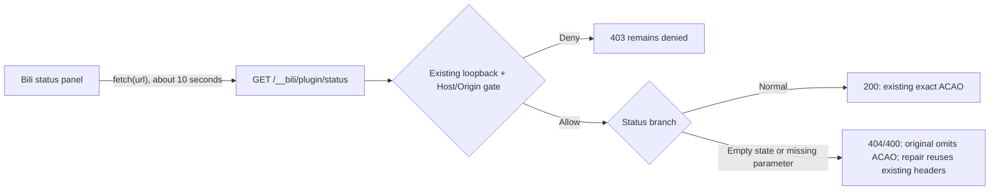

[简体中文](../runtime-repairs.md) | **English**

# Runtime diagnostics and optional compatibility repairs

This page records the classification of the twelve historical log entries, the confirmed narrow defect, and the actual repair evidence. The formal v2 output, independent browser run, live application, and native-renderer status read now have corresponding evidence. The normal official account RPC returns outer HTTP200/ok=true with value.status=failed; its upstream profile request still receives403 and remains unresolved. See the [acceptance report](acceptance.md) for the final-instance observation window and new log categories; these entries are not all described as resolved bugs. That paragraph describes the frozen0.1.4 live review.6 snapshot; later approved0.1.5 maintenance adopted review.7 with unchanged execution code. Earlier published ZIPs remain immutable.

The live Ultimate-Model was updated to `1.4.3-review.7` in this explicitly approved maintenance window. Only five metadata/document files changed; the other 210 files and all execution code retain review.6 bytes. The 0.1.4 statements “live review.6 / maintenance HOLD” describe that earlier snapshot; see [acceptance](acceptance.md) for the later approval and completed maintenance. This is not standing approval for further maintenance or an extension of the spent diagnostic budget.

## What the twelve observations mean

| Observation | Established facts | Conclusion and handling boundary |
| --- | --- | --- |
| One official account-profile read error | The normal account controller received HTTP 403; `network` is a generic non-success-response label. One normal RPC control at 2026-11-07T05:41:22.349Z again returned profile 403/failure | **Not fixed**. This does not establish an offline connection or expired credentials, or require forced sign-in. The repair CLI makes no account request; effects of normal product validation are recorded separately |
| Ten Bili status-poll CORS errors | The renderer requested the public route `/__bili/plugin/status`, mostly at roughly ten-second intervals. The historical records did not retain the actual HTTP status | A missing-header 400/404 branch now reproduces the same CORS symptom, but it has not been proved to be the branch taken by those ten requests. Preserve the history; a later HTTP 200 replay does not establish the earlier result or browser success |
| One rejected tool read | An unbounded `Get-Content` was rejected by the existing read guard. Three bounded reads later in the same turn succeeded | This is an expected protection result. Preserve the guard and rejection evidence rather than allowing unbounded reads to remove the log entry |

Composition inspection confirmed that the current UM6 does not register a second native CUA provider, the old Home UM entry is explicitly disabled, and existing disabled choices and customizations remain intact. Global and preset guard scopes remain separate. This evidence does not establish UM as the cause of these three classes of observation. Healthy startup is not a claim of error-free sessions.

The no-account-change claim is limited to this repair CLI and its response-header byte edits. A separate normal account RPC can cause the official adapter to mark local account state invalid after HTTP 401, so unchanged account state is not guaranteed for the entire maintenance operation. The result recorded here is a 403 failure; this conditional 401 mechanism is not presented as an observed event. The CLI does not edit credentials, and this procedure does not force a new sign-in.

## The confirmed Bili defect

In the reviewed pre-repair bytes, the `billion-context@0.1.212` client polls status with `fetch(url)`, without an explicit second init argument or headers, credentials, cache, or mode options. The server already has loopback, Host, and Origin management gates, including explicit support for trusted `dsh-app://app`. Normal 200 responses include `Access-Control-Allow-Origin` (ACAO) for the exact trusted Origin. However, the trusted no-session/status 404 and missing-conversationId 400 responses contain only content-type and omit the same header.

The browser prevents JavaScript from reading those responses, presenting a normal empty state as a CORS failure. The repair only reuses the original JSON/CORS header logic for these two error branches after the existing gate has allowed the request. It preserves status codes, error bodies, all 200 branches, and 403 rejections for invalid Hosts or Origins. It does not widen global `allowOrigins`, use a wildcard, disable `webSecurity`, or directly change credentials, accounts, models, configuration, OPTIONS handling, or other routes through these header edits or the repair CLI. Normal account RPC validation is a separate step.



The diagram describes production call boundaries. The isolated HTTP-origin browser fixture and the actual native `dsh-app://app` renderer are recorded separately below. The native renderer has read the real proxy's HTTP 404 status; an empty session is not counted as model-task completion.

## Verification already executed

- Preserve the actual-function first RED: five of seven checks passed; the two failures were the trusted 404/400 ACAO assertions. The private minimal prototype passed seven of seven. Only session state, metadata, and request/response objects were synthetic; the whole third-party module was not imported.
- **The formal v2 output was independently retested.** Eleven functions were extracted exactly from the complete 5,863,346-byte actual CLI output, SHA256 `7a4185d855452c04bd15e7a63b490780f5f1ee8f550658b6953283037ecab611`, including the new response-header helper. Eight gate/helper function hashes match the original. The repair-library SHA is `0bbd67ea971d3480b1329db81fa3806a9e8f1eb16f43dd2632bc4ae9ca6bb93b`; the CLI receipt, complete output, and extraction correspondence are linked. This does not reuse the prototype's GREEN.
- The formal output passed a fresh run of **ten real-browser assertions and fourteen real HTTP Node controls**, using Chrome, Playwright Core 1.61.1, and two owned loopback ports. Original 404/400 calls were actually blocked by CORS; the formal output exposed JSON with the same statuses, preserving all three 200 branches. Invalid Hosts/Origins still returned 403 without ACAO. Node `dsh-app://app` header controls remain separate from native-renderer checks.
- That formal browser fixture received 24 GET requests and no OPTIONS requests. Two original CORS-policy and two ERR_FAILED entries remain preserved, as do two expected HTTP 400/404 resource entries for the formal output; pageerror was zero. Both servers and owned Chrome processes exited, source/input hashes remained unchanged, and no model or external page requests were made.
- The maintainer independently ran the portable verifier: **15/15 passed**, with the original input `sourceUnchanged=true` during that acceptance run. All mutations stayed in fresh owned copies, without executing the target third-party module. That read-only-input result does not extend to the later authorized live application.

### Live application, actual adoption, and account control

All times below are UTC on 2026-11-07. Only sanitized results and process relationships are retained; account values, full command lines, and session bodies are not published.

| Stage | Actual evidence and scope |
| --- | --- |
| Formal CLI application at 05:38:16Z | Target SHA is the 7a4185… value above; the new target has `nlink=1`. The original cache hardlink alias retained bytes and mtime; permanent backup/receipt retained |
| New maintenance-validation processes | main925772/Host848472, run prefix5a83…; proxy PID924048 was created at 05:40:59Z with parent848472. The expected index-path match was true; command-line values were not exported |
| Actual Host and proxy | Host `/bili/origin` returned 200. The actual proxy returned readable 400 JSON and exact ACAO for trusted `dsh-app://app` Origin; a foreign origin still received 403 without ACAO |
| Account control at 05:41:22.349Z | One normal account RPC again returned official profile 403/failure. The account path is **not fixed**; CORS repair does not replace account verification |
| Native UI at 05:45:54.037Z | In an actual `dsh-app://app/` window, the Bili conversation-context panel read HTTP 404 status from the real proxy without `Failed to fetch`. This is an empty-session status read: **no Bili model task ran; model requests were zero** |
| Cleanup and final normal restart | Temporary bridge rows were removed and the Home patch restored to its exact 53,822-byte preimage, SHA prefix d184385a…. The temporary secret was deleted only after an exact-hash check. After normal quit/start, final run prefix12630b45…/main851556 started at 05:46:44.779Z |
| Final native UI without a helper at 05:50:38.397Z | Final main851556/Host909416, run prefix12630b45…: the actual `dsh-app://app/` renderer again read HTTP 404 status from the real proxy without `Failed to fetch`; model requests were zero |
| Background readback at 05:51:40Z | The original conversation tab was restored; conversation content was not exported |

The earlier native UI and proxy probes belong to the maintenance-validation process. After cleanup and normal restart, the final process without a helper passed the same native status-read check, and background readback confirmed restoration of the original conversation tab. Both runs establish status-interface readability only; no Bili model task ran.

The independently frozen window is **05:46:44.779Z through 05:49:15.658Z**: three startup health events, zero shutdown/crash events, and zero CORS entries. Its three errors comprised one account entry and two ResizeObserver new-window layout notices. All six protected hashes matched; credentials were checked only as opaque hashes, without decoding. **Periodic ResizeObserver notices remain.** The two-notice count belongs only to that window and is not a final cumulative total. Native verification after 05:50 and extended observation fall outside this frozen window; see the [acceptance report](acceptance.md) for subsequent times, categories, and cumulative counts. This is not a zero-log-error claim or an automatic attribution of layout notices to Bili or UM. The ten historical CORS HTTP statuses remain unknown; the original twelve records are not rewritten.

## Exact bytes supported by the optional repair tool

The entry point is `scripts/repair-bili-status-cors.mjs` in the full-distribution root. It reads the target as data and does not execute or import the target third-party code.

| Object | Bytes | SHA256 |
| --- | ---: | --- |
| Original `billion-context@0.1.212` `dist/index.js` | 5863132 | `e512ccc1880ac2ed82657b779a5e4b518f88ff700baa8a04e399b908e5119599` |
| The same file after the narrow repair | 5863346 | `7a4185d855452c04bd15e7a63b490780f5f1ee8f550658b6953283037ecab611` |

An unknown package name, version, hash, or local customization produces `REVIEW_UPDATE`, exits with code 3, and preserves the original bytes. Exact repaired bytes produce `KEEP`. Do not change a version number, discard a customization, or bypass the hash check to make the tool continue.

### Optional: verify in an owned copy

Run from a trusted full-distribution root. The source bundle may contain either known original or repaired bytes from the table above:

```powershell
node scripts/verify-bili-status-cors.mjs --source-bundle '<EXISTING_BILLION_CONTEXT_BUNDLE_ABSOLUTE_PATH>' --work-dir '<NEW_NONEXISTENT_WORK_DIRECTORY_ABSOLUTE_PATH>'
```

Both paths must be absolute. The work directory must not exist yet, its parent must exist, and it must be outside the repository and source bundle. The verifier writes synthetic copies and receipts only in that fresh directory. It does not change the source or repository, import target third-party code, or call accounts, models, or the network. Count a pass only with exit 0, `status=PASS`, `pass=15`, `fail=0`, `notRun=0`, and `sourceUnchanged=true`. Exits 2/3 mean argument, environment, or source prerequisites are unmet: PREREQ, not a pass. Exit 1 is a failure. Fixtures and the result are retained for inspection.

### Preview first; apply in a maintenance window

Replace each placeholder with your own actual absolute path. Run from a trusted full-distribution root:

```powershell
node scripts/repair-bili-status-cors.mjs --bundle-root '<BILLION_CONTEXT_BUNDLE_ABSOLUTE_PATH>'
```

The default is a read-only plan. `--bundle-root` must be explicit; the tool does not guess the target from Home or environment variables. Applying also requires an **existing, separate backup directory outside the bundle**:

```powershell
node scripts/repair-bili-status-cors.mjs --bundle-root '<BILLION_CONTEXT_BUNDLE_ABSOLUTE_PATH>' --backup-dir '<EXISTING_BACKUP_DIRECTORY_ABSOLUTE_PATH>' --apply
```

The tool checks directory/file identities and the preimage, prepares the candidate, permanent backup, and receipt, then protects publication with compare-and-swap checks and exclusive creation. The observed original target had `nlink=2`. Rather than writing into that shared inode, the tool withdraws the original directory entry, verifies the retained preimage, and publishes a new independent inode, preserving the other hardlink alias's contents. **There is a short path gap between withdrawal and publication. Use a maintenance window and prevent new Host/plugin processes from starting during that interval.** The CLI does not stop, restart, or control DSH automatically.

Concurrent changes or a new target are preserved as conflicts, not overwritten. Backup, target publication, and cleanup results are reported separately. On failure, inspect the target, backup, stage, and receipt, retaining recovery material. Do not delete locks or stages, relax permissions, or retry without a bound. A backup receipt describes the backup point; it alone does not prove target commit or adoption by the running process.

### Restore also defaults to a plan

Use the original receipt created by this tool for the same bundle, and explicitly supply its backup directory:

```powershell
node scripts/repair-bili-status-cors.mjs --bundle-root '<BILLION_CONTEXT_BUNDLE_ABSOLUTE_PATH>' --backup-dir '<EXISTING_BACKUP_DIRECTORY_ABSOLUTE_PATH>' --restore-receipt '<BACKUP_RECEIPT_ABSOLUTE_PATH>'
node scripts/repair-bili-status-cors.mjs --bundle-root '<BILLION_CONTEXT_BUNDLE_ABSOLUTE_PATH>' --backup-dir '<EXISTING_BACKUP_DIRECTORY_ABSOLUTE_PATH>' --restore-receipt '<BACKUP_RECEIPT_ABSOLUTE_PATH>' --apply
```

The first command only plans the restoration; the second executes it. Restoration validates the receipt, backup bytes, directory identity, and current repaired preimage. Changed current contents are retained for review. The current contents receive a separate backup before compare-and-swap restoration of the original bytes; this does not promise to recreate the original hardlink inode. Existing backups and receipts are retained.

Exit codes: 0 for a plan, completion, or `KEEP`; 3 for `REVIEW_UPDATE`; 2 for invalid arguments; 1 for a file-boundary, backup/receipt, concurrency, or I/O failure. The tool does not modify DSH configuration, send model or account requests, access the network, or restart automatically. Update a passing conclusion only after its target-SHA, actual-adoption, and observation-window checks have completed.

## Optional: DSH NEXT footer ResizeObserver repair

Extended local observation also found periodic `ResizeObserver loop completed with undelivered notifications.` messages. The current desktop footer balancer has a confirmed defect: a normal refresh subtracts8px from clientWidth, which includes padding; ResizeObserver supplies contentRect.width with padding already excluded, yet the same subtraction happens again. One144px container therefore yields136px versus128px available width, switching between four and two columns while the old observer writes layout synchronously.

The repair uses one content-box width convention and coalesces this existing observer's writes into the next animation frame. It skips disconnected nodes, cancels the frame during cleanup and prevents a queued microtask from reviving work. It does not replace global observers, swallow error/unhandledrejection, add a resident plugin or invoke a model. Independent browser14/14 and VM boundary6/6 checks passed: original seven native RO notices versus candidate zero; at144px, two columns/68px became four columns/32px. Width boundaries, existing switches, collapsed layout and cleanup were preserved; unrelated JavaScript errors remained visible. Four source-pinning tests, four synthetic archive tests and eight whole-archive fixture cases are separate from later native adoption.

This utility targets an application archive, a narrower scope than UM or Bili. **Exit the matching DSH and Host normally, arrange maintenance and retain permanent backups before applying. Prevent the application/updater from loading this archive during publication.** The CLI does not stop or restart DSH and never guesses paths from the environment:

```powershell
node scripts/repair-dsh-footer-layout.mjs --asar '<APP_ASAR_ABSOLUTE_PATH>' --electron-exe '<DSH_EXE_ABSOLUTE_PATH>'
node scripts/repair-dsh-footer-layout.mjs --asar '<APP_ASAR_ABSOLUTE_PATH>' --electron-exe '<DSH_EXE_ABSOLUTE_PATH>' --backup-dir '<EXISTING_EXTERNAL_BACKUP_DIRECTORY>' --apply
```

The first command only previews; the second applies. The external backup directory must already exist. Supported bytes belong to dsh-desktop-next@2.0.20-next, with full ASAR, executable and native integrity-fuse checks. A matching version label is insufficient. Unknown builds, executables, fuses or local customization return REVIEW_UPDATE; no security switch is disabled to proceed.

| Object | Bytes | SHA256 |
| --- | ---: | --- |
| Original app.asar | 192410998 | `54983f84d351499c90a5be50957065d9bd8b5188c30fc85eb0c67ef2eba0354e` |
| Repaired app.asar | 192730969 | `1c3bc0c92100688532e43173e51d93bcc07350dbcb18a9be65e5346504203fe4` |
| Original packed lib/client.js | 319136 | `1ae5f487d7d8304c5b20321280bc76b11fc8500ad1b599237e00858b38061e0c` |
| Repaired client | 319971 | `680d4dbd4594145c92a7a571ce044862f8bd326bc839873ff13653c4e8e50f46` |
| Supported Windows executable | Read-only check | `af7bb5a976c658fef1627743943599053ee47316e668e2fd0ac053ece5d8dcc5` |

The installed executable's EmbeddedAsarIntegrityValidation fuse was already disabled; this is a preimage observation, not a setting change by the tool. It never modifies the executable, PE resource, fuse or integrity policy. Other builds require separate review. The carrier retains all186919466 original payload bytes, appends the repaired client and changes only that packed entry's offset/size/integrity. Other entries and unpacked files remain intact; dependencies are not repacked or copied. The official asar3.4.1 reader independently validated the result as data. See [third-party notices](../../THIRD-PARTY-NOTICES.md) for provenance and MIT notices.

Apply retains the whole original archive and a before receipt, then writes a separate committed receipt with the new file identity after CAS publication. Restore requires that **committed receipt** and also defaults to a plan:

```powershell
node scripts/repair-dsh-footer-layout.mjs --asar '<APP_ASAR_ABSOLUTE_PATH>' --electron-exe '<DSH_EXE_ABSOLUTE_PATH>' --backup-dir '<SAME_EXTERNAL_BACKUP_DIRECTORY>' --restore-receipt '<COMMITTED_RECEIPT_ABSOLUTE_PATH>'
node scripts/repair-dsh-footer-layout.mjs --asar '<APP_ASAR_ABSOLUTE_PATH>' --electron-exe '<DSH_EXE_ABSOLUTE_PATH>' --backup-dir '<SAME_EXTERNAL_BACKUP_DIRECTORY>' --restore-receipt '<COMMITTED_RECEIPT_ABSOLUTE_PATH>' --apply
```

Restore validates the original backup hash, current repaired bytes, executable and receipt-bound target/directory identities. Later application changes require review. If the target committed but final receipt/cleanup failed, retain committed:true, backups and stage for maintainer inspection; do not automatically treat it as an uncommitted retry. Exit0 is a plan/completion/KEEP,3 REVIEW_UPDATE,2 usage error, and1 a boundary/conflict/I/O failure. After an application update, inspect the new build instead of restoring an old archive over it.

The exact repair was applied locally at2026-11-07T06:17:38Z after normal shutdown, with the whole original, formal receipt and rollback validation retained. Post-adoption independent observation is recorded in [acceptance](acceptance.md). This does not change account403, business-task code or independent observers in other plugins, and it does not guarantee that every RO notice from every source is eliminated forever.

## Distribution and licensing

The distribution contains the narrow repair tool, tests, and instructions. It does not redistribute the installed third-party `dist/index.js` body, the full billion-context bundle, private configuration, accounts, journals, or temporary acceptance helpers. UM6 code and its original ZIP remain unchanged.

This utility uses response-header logic from [billion-context](https://github.com/ranxianglei/billion-context), by ranxianglei. Its LICENSE contains MIT text plus **Additional Term—Attribution on Product Surfaces**, requiring visible attribution on a product surface or in documentation; the [complete original text](../third-party/billion-context.LICENSE.txt) is retained. The complete component and acp-kernel are not redistributed by this utility. Retain [acp-kernel](https://github.com/ranxianglei/acp-kernel) attribution where applicable. These terms do not grant a unified license to the whole UM/share pack. Other source boundaries are in [third-party notices](../../THIRD-PARTY-NOTICES.md).

## Delivery status and remaining boundaries

| Item | Current conclusion | Boundary |
| --- | --- | --- |
| Formal v2 output and independent browser run | PASS | Actual CLI full output, eleven functions, ten browser and fourteen Node controls are linked; this does not verify arbitrary third-party versions |
| Portable isolated verification | PASS | 15/15; the source input was unchanged during that run, with all writes in owned copies |
| Live application and native status interface | PASS, limited path | Exact target bytes, new-proxy adoption, and native-renderer readable HTTP 404; no Bili model task ran |
| Current official account path | **NOT_FIXED** | One normal RPC returned HTTP200/value.failed; its upstream profile request still returned HTTP403. Do not infer an offline connection or expired credentials, or require forced sign-in |
| Final-instance observation | Bounded window checked; see report for extension | That window had CORS0 and three errors: account1 + ResizeObserver2. Periodic RO notices remain; no claim of zero errors or rewritten historical HTTP statuses |

Related guides: [first installation](getting-started.md), [deployment and recovery](deployment.md), [acceptance](acceptance.md), and [real-model records](real-model-validation.md).
