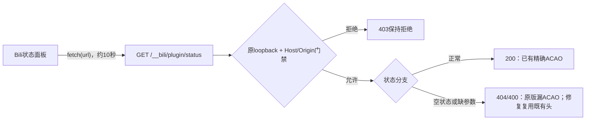

**简体中文** | [English](en/runtime-repairs.md)

# 运行错误分类与可选兼容修复

本文记录历史12条日志的分类、已确证的窄缺陷和本次实际修复证据。正式v2工具输出、独立浏览器复验、live应用及原生renderer状态读取均已有对应证据；官方账号正常RPC外层为HTTP200/ok=true、value.status=failed，上游profile仍返回403，未修复。最终实例观察窗口及新增日志分类见[验收报告](acceptance.md)，不将所有运行日志统称为已解决的bug。本机现役Ultimate-Model仍为`1.4.3-review.6`；分享组件review.7仅改5项兼容元数据/说明，其余210文件（全部执行代码）与review.6相同。旧review.6发行ZIP保持不变。

## 原12条分别代表什么

| 观察 | 已证实的事实 | 当前结论与处理边界 |
| --- | --- | --- |
| 1条官方账号 profile 读取错误 | 正常账号控制器收到HTTP403；`network`是通用非成功响应标签。2026-11-07T05:41:22.349Z仅一次正常RPC对照再次返回profile403/失败 | **未修复**。不能据此推断断网、凭据过期或要求强制重新登录。修复CLI不发账号请求；正常产品验证的副作用另行记录 |
| 10条 Bili 状态轮询 CORS | renderer请求公共route `/__bili/plugin/status`，大多约10秒一次；原始记录未保留实际HTTP状态 | 现已复现一个会造成相同CORS现象的400/404缺头分支，但原10条是否命中该分支仍未证实。保留历史，不把之后的200重放当作当时或浏览器已通过 |
| 1条工具读取拒绝 | 无界 `Get-Content` 被既有读取守卫拒绝；同一turn后续3次有界读取成功 | 这是预期保护结果；保留守卫和拒绝证据，不通过放宽无界读取来消除日志 |

组合审查确认当前 UM6 没有重复注册第二个 native CUA provider，旧 Home UM 项明确停用，原有停用项与定制保持。全局和预设守卫的作用域分别保留。本次证据没有证明上述三类现象由 UM 导致，也没有将启动健康解释成所有会话零错误。

“无账号改动”的范围仅指这个修复CLI及响应头字节修改。独立的正常账号RPC若遇HTTP401，可能由官方适配器更新本地账号失效状态；不能承诺整个维护流程账号状态恒定。本次已记录的是403失败，不将这个401条件机制写成已经发生，也不改凭据或强制重登。

## 已确证的 Bili 缺陷

已审修复前字节中的 `billion-context@0.1.212` 客户端以 `fetch(url)` 轮询状态，没有显式的第二个init参数、headers、credentials、cache或mode选项。服务器已有loopback、Host和Origin管理门禁，并明确支持可信 `dsh-app://app`。正常200响应带精确可信Origin的 `Access-Control-Allow-Origin`（ACAO）；但可信请求的“无会话/状态”404和“缺conversationId”400只返回content-type，遗漏同一响应头。

浏览器会阻止脚本读取这些缺头响应，使正常空状态表现为CORS失败。修复只让这两个已通过原门禁的错误分支复用原JSON/CORS头构造，保留状态码、错误正文、所有200分支及非法Host/Origin的403拒绝。不放开全局 `allowOrigins`，不使用通配符，不禁用 `webSecurity`，这两个响应头修改及修复CLI不直接改凭据、账号、模型、配置、OPTIONS处理或其他路由；正常账号RPC验证是独立步骤。



图描述生产调用边界。下面分别记录独占HTTP-origin浏览器夹具与实际原生 `dsh-app://app` renderer；后者已读取真实proxy的HTTP404状态，未把空会话误记为模型任务完成。

## 当前已经执行的验证

- 保留原始实际函数首红：7项中5过2败，正是可信404/400的ACAO缺失；最小私有原型7/7通过。合成部分仅会话状态、元数据、请求/响应对象，未import整个第三方模块。
- **正式v2产物已独立复验**：从正式CLI实际输出的完整5863346字节文件（SHA256 `7a4185d855452c04bd15e7a63b490780f5f1ee8f550658b6953283037ecab611`）精确提取11个函数，包含新增响应头helper；8个门禁/helper与原版逐函数哈希相同。工具库SHA为 `0bbd67ea971d3480b1329db81fa3806a9e8f1eb16f43dd2632bc4ae9ca6bb93b`，关联CLI回执、完整输出及提取对应关系，没有沿用原型GREEN。
- 正式产物重新通过真实Chrome、Playwright Core1.61.1和两个独占loopback端口的**10项浏览器断言及14项真实HTTP Node对照**。原版404/400实际触发CORS阻断；正式产物的相同状态JSON可读，三个200分支保持。非法Host/Origin仍403且无ACAO；Node的 `dsh-app://app` 头对照与原生renderer分开。
- 该正式浏览器夹具backend为24个GET、0 OPTIONS；原版2条CORS policy与2条ERR_FAILED保留，正式产物2条预期HTTP400/404资源日志保留，pageerror为0。服务器及独占Chrome均退出，源/输入哈希前后未变，没有模型或外部页面请求。
- 可移植验证器由主集成者独立运行**15/15通过**，原始源输入在该轮验收中 `sourceUnchanged=true`。全部变更留在新的owned副本，不执行目标第三方模块。这个只读输入结论不覆盖之后获准的live应用。

### live应用、实际采用与账号对照

所有时间均为2026-11-07 UTC；这里只保留脱敏的结果和进程关联，不公开账号值、完整命令行或会话正文。

| 阶段 | 实际证据与范围 |
| --- | --- |
| 05:38:16Z 正式CLI应用 | 目标SHA为上述7a4185…，新目标 `nlink=1`；原缓存hardlink alias字节和mtime保持，永久备份/receipt留存 |
| 新维护验证进程 | main925772/Host848472，run前缀5a83…；proxy PID924048于05:40:59Z创建、parent848472，命令中预期index路径匹配为true；没有导出命令行值 |
| 实际Host与proxy | Host的 `/bili/origin` 返回200；实际proxy在可信 `dsh-app://app` Origin下返回可读400 JSON与精确ACAO，外源仍403且无ACAO |
| 05:41:22.349Z 账号对照 | 仅一次正常账号RPC再次返回官方profile403/失败，账号路径**未修复**，没有以CORS修复替代账号验证 |
| 05:45:54.037Z 原生UI | 在真实 `dsh-app://app/` 窗口打开Bili会话上下文，renderer实际读取HTTP404状态，未出现 `Failed to fetch`；这是空会话状态读取，**未跑Bili模型任务，模型请求0** |
| 清理与最终正常重启 | 临时bridge行清理后Home patch恢复53822字节精确原像（SHA前缀d184385a…），临时secret精确哈希核对后删除；正常quit/start，最终run前缀12630b45…、main851556于05:46:44.779Z启动 |
| 05:50:38.397Z 最终无helper原生UI | 最终main851556/Host909416、run前缀12630b45…，真实 `dsh-app://app/` renderer再次读取实际proxy的HTTP404状态，无 `Failed to fetch`，模型请求0 |
| 05:51:40Z 后台读回 | 已恢复原对话tab；不导出对话内容 |

较早的原生UI及proxy探针对应维护验证进程；清理并正常重启后，又在最终无helper进程验证了同一原生状态读取，并后台核对恢复原对话tab。两轮证明均限于状态接口可读，未运行Bili模型任务。

独立冻结窗口为 **05:46:44.779Z至05:49:15.658Z**：启动健康事件3，shutdown/crash为0，CORS为0；错误3条分为账号1条、ResizeObserver新窗口布局通知2条，六项保护哈希全部匹配（凭据仅作opaque哈希核对，不解码）。**ResizeObserver周期通知仍存在**，上述2条只对应这一个窗口，不能写成最终总数。05:50后的原生验证及扩展观察发生在此冻结窗口之外，后续起止时间、分类及累计数量见[验收报告](acceptance.md)。不宣称所有日志为零，也不自动将布局通知归因于Bili或UM。历史10条CORS的实际HTTP状态仍未知，不回写原始12条记录。

## 可选修复工具支持的精确字节

入口为完整分享包根目录中的 `scripts/repair-bili-status-cors.mjs`。它只按数据读取目标，不执行或import目标第三方代码。

| 对象 | 字节数 | SHA256 |
| --- | ---: | --- |
| `billion-context@0.1.212` 原始 `dist/index.js` | 5863132 | `e512ccc1880ac2ed82657b779a5e4b518f88ff700baa8a04e399b908e5119599` |
| 窄修复后的同一文件 | 5863346 | `7a4185d855452c04bd15e7a63b490780f5f1ee8f550658b6953283037ecab611` |

未知包名、版本、哈希或本地定制返回 `REVIEW_UPDATE`、退出3，保留原字节。已是精确修复后字节时返回KEEP。不要为了让工具继续而改版本号、抹掉定制或绕过哈希。

### 可选：在独占副本复验

从可信完整分享包根运行；源bundle可为上述已知原始或修复后字节：

```powershell
node scripts/verify-bili-status-cors.mjs --source-bundle '<EXISTING_BILLION_CONTEXT_BUNDLE_ABSOLUTE_PATH>' --work-dir '<NEW_NONEXISTENT_WORK_DIRECTORY_ABSOLUTE_PATH>'
```

两个参数都是绝对路径。work目录必须尚不存在、父目录已存在，且work位于仓库和源bundle之外。验证器只向这个新目录写合成副本与回执，不修改源或仓库、不import第三方目标代码、不调用账号/模型或网络。退出0且 `status=PASS`、`pass=15`、`fail=0`、`notRun=0`、`sourceUnchanged=true` 才计通过；退出2/3为参数、环境或来源前置不满足，记PREREQ而非通过；退出1为失败。夹具与result保留供核对。

### 先预演，再在维护窗口应用

将占位符换成自己的实际绝对路径。在可信完整分享包根目录执行：

```powershell
node scripts/repair-bili-status-cors.mjs --bundle-root '<BILLION_CONTEXT_BUNDLE_ABSOLUTE_PATH>'
```

默认只读预演。`--bundle-root`必须明确提供，不从Home或环境变量猜目标。应用还要求一个**已经存在、独立且在bundle之外**的备份目录：

```powershell
node scripts/repair-bili-status-cors.mjs --bundle-root '<BILLION_CONTEXT_BUNDLE_ABSOLUTE_PATH>' --backup-dir '<EXISTING_BACKUP_DIRECTORY_ABSOLUTE_PATH>' --apply
```

工具先核对目录/文件身份及预像，准备候选、永久备份与receipt，再以CAS和独占发布保护写入。已观察原目标为 `nlink=2`；工具不原地修改共享inode，而是先withdraw原目录项、核验保留原像，再发布独立新inode，避免改变另一个hardlink alias的内容。**withdraw到发布存在短暂路径空缺，须安排维护窗口，阻止新Host/插件进程在此时启动。** CLI不会自动停机、重启或控制DSH。

发现并发改变或新目标时保留冲突，不覆盖；备份、目标发布和清理结果分别报告。失败时依据回执检查目标、备份和stage，保留恢复材料；不要删锁、删stage、放宽权限或无界重试。备份receipt描述备份时点，不能单独当作目标已提交、现役进程已采用的证明。

### 恢复也默认预演

使用本工具为同一bundle创建的原receipt，并明确给出对应备份目录：

```powershell
node scripts/repair-bili-status-cors.mjs --bundle-root '<BILLION_CONTEXT_BUNDLE_ABSOLUTE_PATH>' --backup-dir '<EXISTING_BACKUP_DIRECTORY_ABSOLUTE_PATH>' --restore-receipt '<BACKUP_RECEIPT_ABSOLUTE_PATH>'
node scripts/repair-bili-status-cors.mjs --bundle-root '<BILLION_CONTEXT_BUNDLE_ABSOLUTE_PATH>' --backup-dir '<EXISTING_BACKUP_DIRECTORY_ABSOLUTE_PATH>' --restore-receipt '<BACKUP_RECEIPT_ABSOLUTE_PATH>' --apply
```

第一条只给恢复计划，第二条才执行。恢复验证receipt、备份字节、目录身份和当前修复后预像；当前内容已改变时保留审查。恢复前保留当前内容的独立备份，通过CAS恢复原字节，不承诺重建最初hardlink inode。已有备份和receipt保留。

退出码：0为预演/完成/KEEP，3为REVIEW_UPDATE，2为参数错误，1为文件边界、备份/receipt、并发或I/O失败。工具不修改DSH配置，不发模型或账号请求，不联网，不自动重启。只有后续对目标SHA、实际采用和观察窗口的验证完成，才更新相应通过结论。

## 可选：DSH NEXT 页脚 ResizeObserver 修复

本机延长观察另发现周期性 `ResizeObserver loop completed with undelivered notifications.`。已定位当前桌面客户端页脚排版器的确定缺陷：常规刷新用含内边距的clientWidth再扣8px；ResizeObserver传入已经排除内边距的contentRect.width，却再次扣8px。相同144px容器会得到136px和128px两种可用宽度，在四列/两列之间切换；原回调还同步写入布局。

修复统一content-box宽度，在这个既有observer内部将多次更新合并到下一帧，跳过断连节点，cleanup取消帧并防止迟到的microtask复活。它不替换全局observer、不吞error/unhandledrejection，也不增加常驻插件或模型请求。实际浏览器独立14/14及VM边界6/6通过：原版7次原生RO通知、候选0次；144px从两列/68px高变为四列/32px高。边界宽度、原开关、收起布局和cleanup保持，无关JavaScript错误仍正常上报。另有4项源固定测试、4项归档合成测试和8项完整归档夹具验证；这些不替代本机采用后的观察。

该工具操作的是应用归档，适用范围比UM或Bili更窄。**须先正常退出对应DSH及其Host，安排维护窗口，保留长期备份；不要在应用/更新器仍加载该归档时应用。** CLI不自动停机或重启，只读取明确给出的路径，不从环境猜目标：

```powershell
node scripts/repair-dsh-footer-layout.mjs --asar '<APP_ASAR_ABSOLUTE_PATH>' --electron-exe '<DSH_EXE_ABSOLUTE_PATH>'
node scripts/repair-dsh-footer-layout.mjs --asar '<APP_ASAR_ABSOLUTE_PATH>' --electron-exe '<DSH_EXE_ABSOLUTE_PATH>' --backup-dir '<EXISTING_EXTERNAL_BACKUP_DIRECTORY>' --apply
```

第一条只读预演，第二条才应用。备份目录必须已存在，且在应用目录之外。支持字节为`dsh-desktop-next@2.0.20-next`，同时检查完整ASAR、EXE和原生完整性fuse状态；同版本号不代表字节兼容。未知版本、EXE、fuse或本地定制返回REVIEW_UPDATE，绝不关闭安全开关来继续。

| 对象 | 字节数 | SHA256 |
| --- | ---: | --- |
| 原app.asar | 192410998 | `54983f84d351499c90a5be50957065d9bd8b5188c30fc85eb0c67ef2eba0354e` |
| 修复后app.asar | 192730969 | `1c3bc0c92100688532e43173e51d93bcc07350dbcb18a9be65e5346504203fe4` |
| 原packed lib/client.js | 319136 | `1ae5f487d7d8304c5b20321280bc76b11fc8500ad1b599237e00858b38061e0c` |
| 修复后client | 319971 | `680d4dbd4594145c92a7a571ce044862f8bd326bc839873ff13653c4e8e50f46` |
| 支持的Windows EXE | 仅只读校验 | `af7bb5a976c658fef1627743943599053ee47316e668e2fd0ac053ece5d8dcc5` |

本机EXE原有的EmbeddedAsarIntegrityValidation为disabled；这是对原像的读取，不是工具进行的修改。工具不会改EXE、PE资源、fuse或完整性设置；其他构建须单独审查。归档构造保留186919466字节原payload，追加修复client，只更新这个packed entry的offset/size/integrity；其他entry和unpacked文件保留，不重新打包或复制整套依赖。官方asar3.4.1已按数据独立读回验证。来源及MIT声明见[第三方说明](../THIRD-PARTY-NOTICES.md)。

应用先保存完整原归档和before receipt，CAS提交后再保存含新文件身份的committed receipt。恢复须使用**committed receipt**，同样默认只读：

```powershell
node scripts/repair-dsh-footer-layout.mjs --asar '<APP_ASAR_ABSOLUTE_PATH>' --electron-exe '<DSH_EXE_ABSOLUTE_PATH>' --backup-dir '<SAME_EXTERNAL_BACKUP_DIRECTORY>' --restore-receipt '<COMMITTED_RECEIPT_ABSOLUTE_PATH>'
node scripts/repair-dsh-footer-layout.mjs --asar '<APP_ASAR_ABSOLUTE_PATH>' --electron-exe '<DSH_EXE_ABSOLUTE_PATH>' --backup-dir '<SAME_EXTERNAL_BACKUP_DIRECTORY>' --restore-receipt '<COMMITTED_RECEIPT_ABSOLUTE_PATH>' --apply
```

恢复核对原备份哈希、当前修复后字节、EXE及receipt中的目标/目录身份；后来改过的应用保留审查，不覆盖。若目标已提交但最终receipt或清理失败，按`committed:true`处理，保留备份/stage并由维护者核验，不能当成“未提交”自动重试。退出0表示计划/完成/KEEP，3为REVIEW_UPDATE，2为参数错误，1为边界/并发/I/O失败。应用升级后先核对新版本，不能用旧备份覆盖新版本。

本机已于2026-11-07T06:17:38Z正常停机后应用，完整原像、正式receipt和回退验证保留；实际采用后的独立观察以[验收报告](acceptance.md)为准。该修复不涉及账户403、业务任务代码或其他插件独立的observer，不能据此承诺所有来源的RO通知永不再发生。

## 分发与许可

分享包提供窄修复工具、测试及说明，不分发已安装第三方 `dist/index.js` 正文、整份billion-context bundle、私有配置、账号、journal或临时验收辅助。UM6代码与原ZIP不变。

本工具使用 [billion-context](https://github.com/ranxianglei/billion-context)（作者ranxianglei）的响应头构造逻辑。其LICENSE包含MIT文本及 **Additional Term—Attribution on Product Surfaces**，要求产品界面或文档中的可见出处；[完整原文](third-party/billion-context.LICENSE.txt)已保留。完整组件及acp-kernel不在本工具中分发；涉及上游内核时保留 [acp-kernel](https://github.com/ranxianglei/acp-kernel) 出处。这些条款不构成整个UM/分享包的统一许可。其他来源范围见[第三方声明](../THIRD-PARTY-NOTICES.md)。

## 交付状态与剩余边界

| 项目 | 当前结论 | 边界 |
| --- | --- | --- |
| 正式v2输出与独立浏览器 | PASS | 实际CLI完整输出/11函数/10浏览器+14 Node关联，不替代任意第三方版本验收 |
| 可移植隔离验证 | PASS | 15/15，源输入在该次验收前后未变；全部写入仅owned副本 |
| live应用与原生状态接口 | PASS（限定路径） | 精确目标字节、新proxy采用、原生renderer可读HTTP404；未运行Bili模型任务 |
| 当前官方账号路径 | **NOT_FIXED** | 正常一次RPC为HTTP200/value.failed，上游profile仍HTTP403；不推断断网或凭据过期，不强制重登 |
| 最终实例观察 | 限定窗口已核对；扩展见报告 | 上述窗口CORS0，错误3=账号1+ResizeObserver2；RO周期通知仍存，不宣称全部零错误，不回写历史HTTP状态 |

相关入口：[首次安装](getting-started.md)、[部署与恢复](deployment.md)、[验收报告](acceptance.md)、[真实模型记录](real-model-validation.md)。
